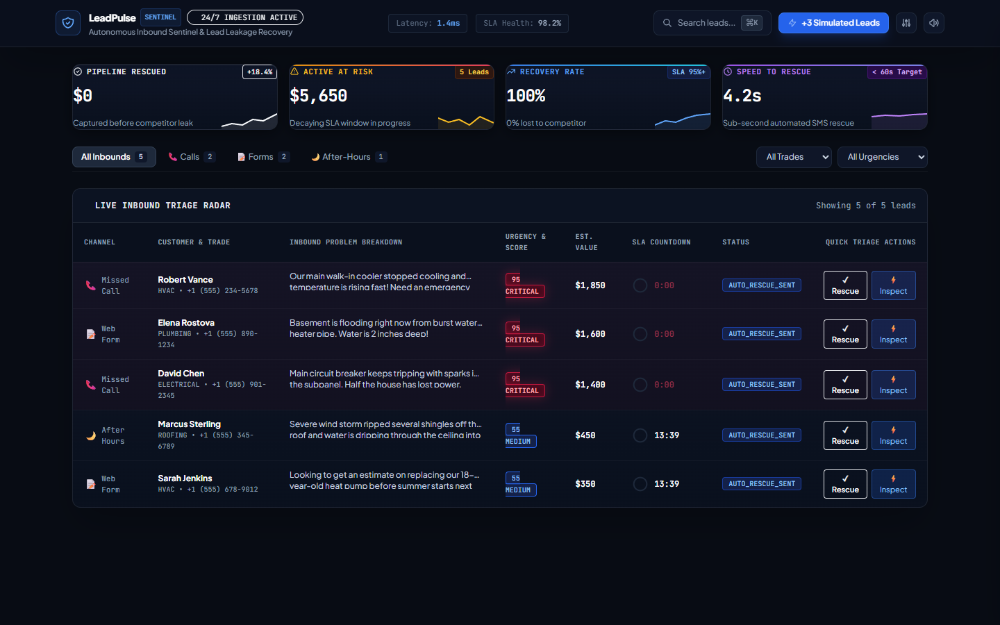
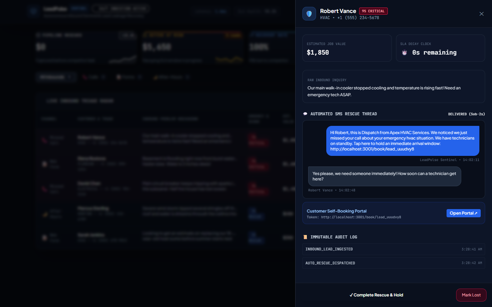
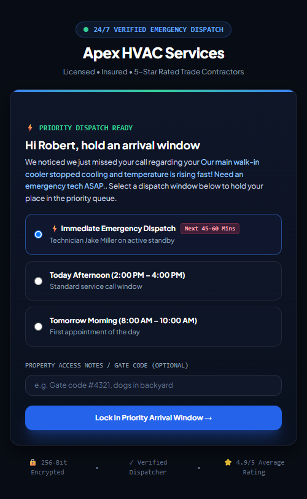

# LeadPulse Sentinel

> A missed-lead triage dashboard for trade contractors: it scores each inbound inquiry for urgency with keyword rules, estimates job value, and creates a self-booking page, so a missed call can still turn into a booked visit.

**Status:** Prototype. SMS sending is simulated: no SMS or telephony provider is connected (see [Limitations](#limitations)). 14 tests in the documented runner (`node --test tests/standalone_runner.js`).
**Demo:** none hosted. Run it locally in one command (below); screenshots follow.



<p align="center">
  
  &nbsp;
  
</p>

## Quickstart

Requires Node.js 20 or newer. The server path below has no install step: `src/server/nativeServer.js` imports only Node built-ins.

```bash
git clone https://github.com/HamzaKhanBUIC/leadpulse-sentinel.git
cd leadpulse-sentinel
node src/server/index.js          # dashboard at http://localhost:3001
node --test tests/standalone_runner.js   # 14 tests
```

Try it: post a lead, then open the dashboard.

```bash
curl -X POST http://localhost:3001/api/v1/leads/ingest \
  -H "Content-Type: application/json" \
  -d '{"channel":"MISSED_CALL","customer_phone":"+15550100","raw_inquiry_text":"burst pipe flooding basement"}'
```

That request returns a `CRITICAL` lead with an `l_score` of 95 and a 60-second SLA. To see the customer page, open the lead in the dashboard and use its booking link (`/book/<lead id>`). Lead IDs are random, so there is no fixed preview URL.

What it does:

- **Urgency scoring.** Keyword lists in `src/core/sentinel/urgencyClassifier.ts` give a 0-100 `l_score` and an SLA of 60 s, 3 min, 15 min or 60 min. This is rule matching, not a language model.
- **Job value estimate.** A lookup by trade and severity, $120 to $12,000 (`valuationModel.ts`).
- **Metrics.** `GET /api/v1/metrics` returns pipeline rescued, at risk and recovery rate from the in-memory store.
- **Customer booking page** at `/book/:id`, and a dispatcher dashboard with a command palette (Ctrl+K or Cmd+K).
- **Simulator.** `POST /api/v1/simulate/burst` injects fake leads (up to 50 per call); `POST /api/v1/simulate/clear` wipes the store. Both need the admin token.

### API

| Method | Endpoint | Description |
| :-- | :-- | :-- |
| `GET` | `/api/v1/leads` | All leads with SLA status |
| `POST` | `/api/v1/leads/ingest` | New lead (`channel`, `customer_phone`, `raw_inquiry_text`) |
| `GET` | `/api/v1/leads/:id` | One lead with its audit trail |
| `POST` | `/api/v1/leads/:id/action` | `MARK_RESCUED` or `MARK_LOST` |
| `POST` | `/api/v1/leads/:id/book` | Customer slot booking (`slot_id`, `notes`) |
| `POST` | `/api/v1/leads/:id/sms` | Dispatcher message (stored in the lead, not sent) |
| `POST` | `/api/v1/leads/:id/assign` | Assign a truck |
| `GET` | `/api/v1/metrics` | Ledger numbers |
| `POST` | `/api/v1/simulate/burst`, `/api/v1/simulate/clear` | Simulator, admin token required |

## Configuration

| Variable | Default | Description |
| :-- | :-- | :-- |
| `PORT` | `3001` | HTTP port (`src/server/index.js`). |
| `LEADPULSE_ADMIN_TOKEN` | unset | At least 16 characters. Required for the two simulator routes, which are refused (403) while it is unset. Send it as the `X-Admin-Token` header; the dashboard asks for it in a prompt. |

The booking link in each generated message always starts with `http://localhost:3001`, whatever `PORT` is (`src/core/rescue/autoRescueDispatcher.js`). There is no setting for it yet.

## Limitations

- **SMS is simulated.** No message is sent. The rescue payload is built in memory and its `delivery_status` is hard-coded to `DELIVERED` (`autoRescueDispatcher.js`). The dispatcher "SMS" thread only stores text, and the first "customer" reply in it is canned demo text.
- **No telephony.** "Missed call" means a JSON `POST` to `/api/v1/leads/ingest`. There are no VoIP webhooks and no signature check.
- **Booking links are not tokens.** The link uses the lead ID, generated with `Math.random`. It is not single-use and it does not expire.
- **In-memory only.** Restarting the server loses all leads.
- **No login.** Dispatcher routes (`/action`, `/sms`, `/assign`) and lead reads have no authentication; only the simulator routes need the admin token. Do not expose the server to a network.
- **Keyword classifier**, no language model, no benchmark. The per-request speed is not measured.
- **Two code paths.** The documented server is `src/server/nativeServer.js` with `.js` files. An Express + React + Vite path (`.ts`, `src/client/`) exists alongside it and has diverged. `npm test` runs Vitest over both and had 6 failing tests on this branch, so use the `node --test` command above. `npm run build` fails type-checking in `src/server/app.ts` (3 errors).
- The dashboard loads Tailwind from a CDN with no integrity check, so it needs internet access.
- Market statistics from earlier versions of this README are not repeated here; they had no linked sources.

## License

MIT. See [LICENSE](LICENSE).

